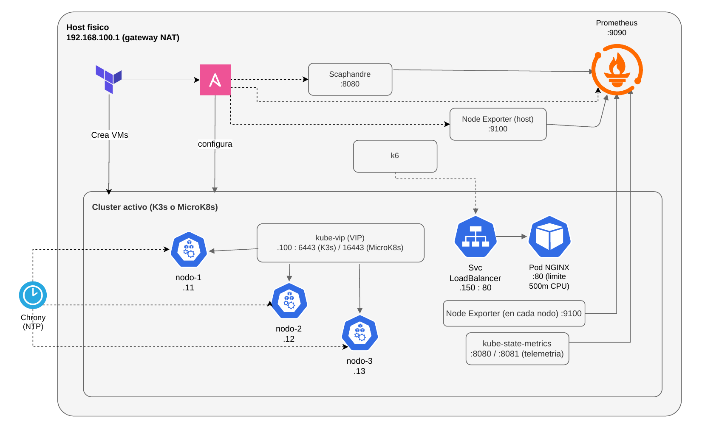

# Eficiencia energética y rendimiento de clústeres HA con K3s y MicroK8s

Proyecto de título — Ingeniería Civil Informática, Universidad Católica de Temuco.
Autor: José Ignacio Delpino Muñoz.

Comparo K3s y MicroK8s en Alta Disponibilidad (3 nodos) sobre un único host físico con recursos limitados. Mido la energía que consume el host (RAPL, vía Scaphandre) y el rendimiento de cada plataforma bajo carga controlada. Solo corre un clúster a la vez, para no mezclar la energía de ambas en una medición.

**Pregunta de investigación:** ¿cómo difieren K3s y MicroK8s en HA en la energía contabilizada por el host y en su rendimiento bajo carga controlada, y qué compromisos entre eficiencia y resiliencia se observan?

## Estado

- Etapas 1 (problema) y 2 (diseño) entregadas.
- Etapa 3: ambos clústeres, la observabilidad, la aplicación de referencia, k6, la calibración y los pilotos están hechos. Resultados y anomalías en [`docs/evidencia/evidencia_T-20.md`](docs/evidencia/evidencia_T-20.md).
- Etapa 4: campaña definitiva y análisis estadístico, pendientes. `analysis/` solo tiene scripts de verificación.

## Arquitectura



Cada nodo corre kube-vip como DaemonSet en modo ARP. El pod que gana el *lease* asume la VIP `.100` (plano de control) y la `.150` (Service LoadBalancer de NGINX). El puerto de la API depende de la distribución: `6443` en K3s, `16443` en MicroK8s.

Más diagramas: [topología de red](docs/img/topologia.png) · [observabilidad](docs/img/observabilidad.png).

## Laboratorio

| Componente | Valor |
|---|---|
| Host | ThinkPad T14 Gen 2, Ryzen 7 PRO 5850U (8 núcleos / 16 hilos), 16 GB, NVMe 512 GB, Ubuntu 24.04 |
| Virtualización | QEMU/KVM + libvirt, Terraform (`dmacvicar/libvirt` 0.7.6) y Ansible |
| VMs | 3 por clúster, Ubuntu Server 24.04, 2 vCPU / 4 GB / 50 GB; cada VM fijada (`vcpupin`) a 2 hilos del host; k6 usa las CPU 0 y 1 |
| Red | libvirt NAT `192.168.100.0/24`: host `.1`, nodos `.11`–`.13` (IP por MAC), VIP plano de control `.100`, VIP del Service `.150` |
| K3s | `v1.36.3+k3s1`, etcd embebido |
| MicroK8s | canal `1.36/stable` con `snap refresh --hold`, Dqlite |
| kube-vip | `v1.2.4`, ARP, `svc_election: "false"` |
| App de referencia | `nginx:1.30.6` con njs: SHA-256 repetido 300 veces por solicitud, 1 réplica, CPU request `500m` / límite `2000m`, `.150:80` |
| Scaphandre | `v1.0.3` en el host, exportador Prometheus en `127.0.0.1:8080`, dominio `package` |
| Node Exporter | `1.12.1` en host y VMs, 6 colectores, puerto 9100 |
| Prometheus | `3.15.0` nativo en el host (systemd), scrape 10 s, etiqueta `distribution` |
| kube-state-metrics | `v2.20.0`, NodePort 30080/30081 |
| k6 | `v2.3.0` en el host, ejecutor `ramping-arrival-rate` |
| chrony | host como servidor NTP, VMs como clientes solo de `192.168.100.1` |

## Estructura del repositorio

```
├── k3sHA/ , microk8sHA/   Terraform + Ansible de cada clúster (misma estructura; ver su README)
├── ansible/               Playbook del host: scaphandre, node_exporter, prometheus, k6, chrony,
│                          operador_host, host_mediciones (modo medición)
├── k8s/                   Plantillas de NGINX, Service y kube-state-metrics
├── k6/                    Paquete Python y scripts, por función:
│     escenarios/ (k6 JS)  lib/ (módulos compartidos)  medicion/ (orquestador, plan, pilotos)
│     calibracion/  diagnostico/ (reposo del host, desfase de potencia)  operacion/ (despliegue, fallo manual)
├── analysis/verificacion/ Scripts de verificación sobre Prometheus
├── data/                  Resultados versionados (ver data/README.md)
└── docs/                  Entregables, evidencias (docs/evidencia/) y diagramas (docs/img/)
```

## Cómo funciona el laboratorio

### 1. Levantar y destruir un clúster

```bash
k6/operacion/despliegue.sh <k3s|microk8s> construir <ciclo>
k6/operacion/despliegue.sh <k3s|microk8s> destruir <ciclo>
```

`despliegue.sh` encadena `terraform apply`, `limpia_fingerprint.sh` y el playbook del clúster, y registra los tiempos por fase en `data/despliegue/despliegue_<distribución>.jsonl`. Los pasos manuales equivalentes están en el README de cada distribución.

Requisitos: libvirt funcionando, Terraform, Ansible, imagen cloud de Ubuntu 24.04 y un `terraform.tfvars` propio con `base_image` y `cluster_user`. Llaves, `tfvars`, `tfstate` e `inventory.ini` no se versionan.

### 2. Preparar el host

```bash
cd ansible
ansible-playbook playbook.yml --ask-become-pass -e active_distribution=<k3s|microk8s>
```

Instala Scaphandre, Node Exporter, Prometheus, k6 y chrony en el host, y deja la etiqueta `distribution` de Prometheus con la distribución activa. También instala `tesis-modo-medicion`, que deja al host en estado de medición: sin sesión gráfica, solo las unidades permitidas, perfil `balanced` y CPU boost apagado. El estado vive en `/run`, así que se pierde al reiniciar. Tras cada corrida del playbook hay que repetir `salir` y `entrar`:

```bash
sudo /usr/local/sbin/tesis-modo-medicion entrar      # y `salir` al terminar
```

### 3. Calibrar y medir

```bash
# desde la raíz del repositorio
python3 -m k6.calibracion.calibrar --distribucion <dist> --tasas 100,200,400,800,1200,1600,1800,2000,2400 --seguir
k6/medicion/secuencia_piloto.sh <dist> <tasa_media> <tasa_alta> [repeticiones]
```

- `calibrar.py` sube la tasa por escalones hasta encontrar la última sostenible (≥99 % aplicada, ≤0,1 % fallidas, pod con throttling de CFS ≤1 % de los periodos, k6 con CPU <85 %). Resultado actual: techo de ≈1100 rps en K3s y ≈1000 rps en MicroK8s; ahí satura el nodo, no el generador.
- `secuencia_piloto.sh` corre `idle`, `media` y `alta` con 3 repeticiones cada una (tasas fijadas con la aplicación actual: `media` 450 y `alta` 900 rps, iguales en ambas distribuciones; los pilotos ya hechos usaron NGINX estático y 900/1600 rps). Cada repetición pasa por `python3 -m k6.medicion.orquestador`: espera a que los relojes converjan, lanza k6, lee RAPL antes y después de la fase estable, consulta Prometheus y escribe los metadatos.
- Las corridas de medición las lanzo desde la consola de texto, con la sesión gráfica cerrada.
- Fallo controlado: `python3 -m k6.medicion.orquestador --fallo` mata el proceso de orquestación (`k3s` o `snap.microk8s.daemon-kubelite`) en el nodo que sostiene las VIP, durante carga media.

## Protocolo experimental (diseño)

- Carga abierta (`ramping-arrival-rate`) generada por k6 en el host: ascenso 30 s, fase estable 3 min (única ventana de medición), descenso 30 s.
- Escenarios: `idle`, `media` (50 % de la tasa de saturación) y `alta` (justo bajo la saturación).
- Diseño contrabalanceado en dos bloques (K3s→MicroK8s y MicroK8s→K3s), 5 repeticiones por distribución y bloque; el número queda sujeto a análisis de potencia.
- Solo se falla 1 de 3 nodos a la vez para conservar quórum.
- Análisis: Shapiro-Wilk, t de Student/Welch o Mann-Whitney U, delta de Cliff o d de Cohen, corrección de Holm.

## Diferencias entre K3s y MicroK8s

| Aspecto | K3s | MicroK8s |
|---|---|---|
| Instalación | script `get.k3s.io` | snap con canal fijado |
| Unión de nodos | `--server` + token | `add-node` / `join` con token de un solo uso, un nodo a la vez |
| Manifiesto de kube-vip | auto-aplicado desde el directorio de manifiestos | `kubectl apply` explícito |
| Estabilización del arranque | sin ajustes extra | `apiserver-kicker` enmascarado, `refresh-certs` tras cada `join`, timeouts largos |
| Datastore / puerto API | etcd / `6443` | Dqlite / `16443` |

## Limitaciones conocidas

- Un único host físico; con SMT, cada VM comparte núcleo físico con su hilo hermano.
- El canal `1.36/stable` de MicroK8s no es una versión exacta; queda fija después del primer install.
- La imagen base de Ubuntu no tiene checksum registrado.
- Con `svc_election: "false"` el nodo que sostiene las VIP depende de qué pod toma el *lease*; cada repetición lo registra en sus metadatos.
- El NGINX estático no exigía al nodo: con límite `500m` el techo era el estrangulamiento del pod y con `2000m` el generador k6. Apliqué la contingencia SHA-256 de la Etapa 2 (njs, N = 300, valor inicial sin otros probados); detalle en `evidencia_T-20.md`, secciones 6.5 y 6.6.
- Entre sesiones de medición distintas la potencia absoluta del host cambia en torno a 1 W con la misma carga (curvas paralelas); dentro de una sesión la desviación es ≤0,03 W. Causa sin identificar; detalle en `evidencia_T-20.md`, sección 7.4.
- El contador RAPL se desborda cada ~8500 s a 7,7 W; el orquestador lo corrige, pero el análisis debe corregir también las muestras crudas de Scaphandre.
- La política de reloj acepta un desfase del host de hasta 100 ms respecto a NTP (VMs ≤5 ms respecto al host).

## Enlaces

- Backlog: <https://github.com/users/Coto2412/projects/2>
- Evidencias: [`docs/evidencia/`](docs/evidencia/)
- Informe de Etapa 1: [`docs/Entrega_1_Proyecto_de_Título.pdf`](docs/Entrega_1_Proyecto_de_Título.pdf)
- Informe de Etapa 2: [`docs/Entrega_2_Proyecto_de_Título.pdf`](docs/Entrega_2_Proyecto_de_Título.pdf)
- Pauta y rúbrica: [`docs/Pauta_y_Rubrica_Trabajo_de_Titulo.pdf`](docs/Pauta_y_Rubrica_Trabajo_de_Titulo.pdf)
- Diagramas fuente: [`docs/diagrama_arquitectura.drawio.pdf`](docs/diagrama_arquitectura.drawio.pdf), [`docs/topologia_red.drawio.pdf`](docs/topologia_red.drawio.pdf), [`docs/arquitectura_observabilidad.drawio.pdf`](docs/arquitectura_observabilidad.drawio.pdf)

Cada clúster: [`k3sHA/README.md`](k3sHA/README.md) · [`microk8sHA/README.md`](microk8sHA/README.md)
