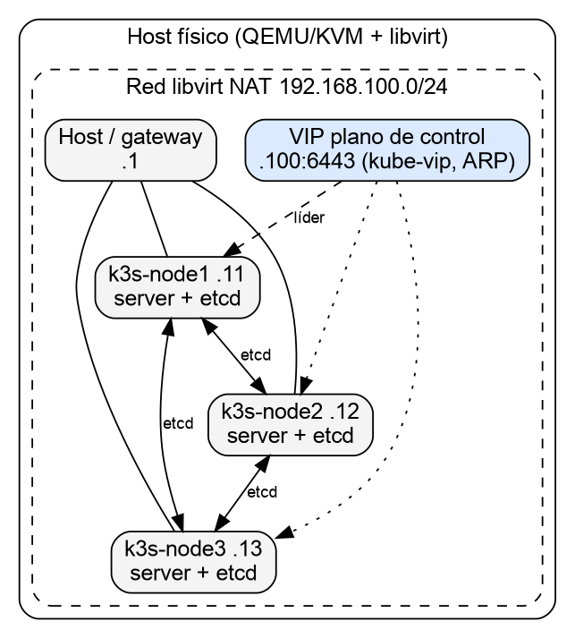

# K3s — clúster HA

Volver al [README raíz](../README.md) · [MicroK8s](../microk8sHA/README.md)

Terraform + Ansible para un clúster K3s de 3 nodos (todos plano de control, etcd embebido) con kube-vip.



## Estructura

```
k3sHA/
├── terraform/             red libvirt NAT, volúmenes, cloud-init, 3 VMs con vcpupin (config/vcpupin.xsl.tftpl)
├── ansible/
│   ├── playbook.yml
│   ├── group_vars/all.yml versiones, puerto de la API, interfaz de kube-vip, servidor chrony
│   └── roles/             common, ssh_config, k3s_server, kube_vip, chrony, node_exporter,
│                          kube_state_metrics, nginx_referencia
├── keys/                  llaves SSH locales (no versionadas)
├── limpia_fingerprint.sh  limpia known_hosts y valida conectividad
└── nat_on.sh / nat_off.sh NAT temporal del host hacia la red de las VMs
```

## Despliegue

```bash
cd k3sHA
ssh-keygen -t ed25519 -f keys/key -N ""
cat > terraform/terraform.tfvars <<EOF
base_image   = "<ruta_a_imagen_ubuntu_24.04>"
cluster_user = "<usuario_admin>"
EOF
(cd terraform && terraform init && terraform apply)
./limpia_fingerprint.sh
(cd ansible && ansible-playbook playbook.yml)
ssh -i keys/key <usuario_admin>@192.168.100.100 kubectl get nodes -o wide     # 3 nodos Ready
```

Destruir: `cd terraform && bash limpia.sh`. Lo normal es usar `k6/operacion/despliegue.sh k3s construir|destruir <ciclo>` desde la raíz, que además cronometra cada fase.

## Variables principales

| Variable | Valor |
|---|---|
| `vm_memory` / `vm_cpu` / `vm_disk_size` | 4096 MB / 2 / 50 GB (`terraform/variables.tf`) |
| `vm_ips`, `vip_address` | `.11`, `.12`, `.13`; VIP `.100` |
| `k3s_version` | `v1.36.3+k3s1` |
| `kube_vip_version`, `kube_vip_svc_election` | `v1.2.4`, `"false"` |
| `kube_vip_port` | `6443` |
| `kube_vip_interface` | `ens3` |
| `chrony_servidor` | `192.168.100.1` (el host) |

## Cómo se configura

- **Instalación:** script oficial `get.k3s.io` con `INSTALL_K3S_VERSION` fijo.
- **Primer nodo:** `--cluster-init`. Los otros dos se unen directo a `k3s-node1` (no por la VIP) con `--server` y el token.
- **`--tls-san`:** VIP + IP de cada nodo, armado desde el inventario.
- **Sin `--bind-address`:** la API escucha en `0.0.0.0`. Con kube-vip en ARP, si solo escuchara en la IP propia del nodo, nadie respondería en `<VIP>:6443` cuando ese nodo es el titular.
- **`--disable traefik --disable servicelb`:** Traefik crea un Service LoadBalancer y kube-vip le asignó la IP del propio nodo, tumbando su red. Tampoco forman parte del diseño.
- **kube-vip:** manifiesto en `/var/lib/rancher/k3s/server/manifests/`, K3s lo aplica solo. Modo ARP con `cp_enable` y `svc_enable`; la IP del Service se fija con la anotación `kube-vip.io/loadbalancerIPs`. Elige líder contra el apiserver local (`KUBERNETES_SERVICE_HOST=127.0.0.1`), así la VIP queda acoplada al proceso de K3s del nodo: si K3s muere, la VIP migra (16,7–22,7 s medidos, ver [`evidencia_T-19.md`](../docs/evidencia/evidencia_T-19.md)).

## Verificaciones útiles

```bash
kubectl get nodes -o wide                                   # 3 nodos Ready, control-plane,etcd
kubectl -n kube-system get pods -l name=kube-vip-ds -o wide # kube-vip en los 3 nodos
kubectl -n kube-system get pods -l component=etcd           # miembros de etcd
```

No hay tarea automatizada que revise la salud de etcd; es inspección manual.

## Problemas ya resueltos en el código

| Síntoma | Causa | Solución |
|---|---|---|
| Un nodo pierde la red al quedar kube-vip `Running` | Traefik/ServiceLB crean un Service LoadBalancer y kube-vip le da la IP del nodo | `--disable traefik --disable servicelb` |
| La API no responde en la VIP aunque kube-vip esté `Running` | `--bind-address` fijado a la IP del nodo | se quitó el flag |
| La VIP no migraba al matar `k3s` | kube-vip del nodo caído seguía renovando su *lease* | elección de líder contra el apiserver local |
