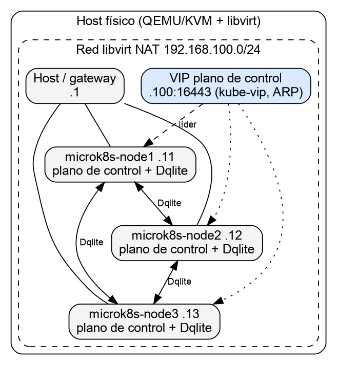

# MicroK8s — clúster HA

Volver al [README raíz](../README.md) · [K3s](../k3sHA/README.md)

Terraform + Ansible para un clúster MicroK8s de 3 nodos (todos plano de control, Dqlite) con kube-vip.



## Estructura

```
microk8sHA/
├── terraform/             red libvirt NAT, volúmenes, cloud-init, 3 VMs con vcpupin (config/vcpupin.xsl.tftpl)
├── ansible/
│   ├── playbook.yml
│   ├── group_vars/all.yml canal de MicroK8s, hold del snap, puerto de la API, interfaz de kube-vip
│   └── roles/             common, ssh_config, microk8s_server, kube_vip, chrony, node_exporter,
│                          kube_state_metrics, nginx_referencia
├── keys/                  llaves SSH locales (no versionadas)
├── limpia_fingerprint.sh  limpia known_hosts y valida conectividad
└── nat_on.sh / nat_off.sh NAT temporal del host hacia la red de las VMs
```

## Despliegue

```bash
cd microk8sHA
ssh-keygen -t ed25519 -f keys/key -N ""
cat > terraform/terraform.tfvars <<EOF
base_image   = "<ruta_a_imagen_ubuntu_24.04>"
cluster_user = "<usuario_admin>"
EOF
(cd terraform && terraform init && terraform apply)
./limpia_fingerprint.sh
(cd ansible && ansible-playbook playbook.yml)
ssh -i keys/key <usuario_admin>@192.168.100.100 microk8s kubectl get nodes -o wide     # 3 nodos Ready
```

El primer arranque de cada nodo tarda varios minutos (pull de imágenes de Calico en 2 vCPU); los timeouts del playbook ya lo consideran. Destruir: `cd terraform && bash limpia.sh`. Lo normal es usar `k6/operacion/despliegue.sh microk8s construir|destruir <ciclo>` desde la raíz.

## Variables principales

| Variable | Valor |
|---|---|
| `vm_memory` / `vm_cpu` / `vm_disk_size` | 4096 MB / 2 / 50 GB (`terraform/variables.tf`) |
| `vm_ips`, `vip_address` | `.11`, `.12`, `.13`; VIP `.100` |
| `microk8s_channel` | `1.36/stable` (canal, no versión exacta) |
| `snap_refresh_timer` | `forever` (congela la revisión tras el install) |
| `microk8s_worker_flag` | `false`: los 3 nodos son plano de control |
| `kube_vip_version`, `kube_vip_svc_election` | `v1.2.4`, `"false"` |
| `kube_vip_port` | `16443` |
| `kube_vip_interface` | `ens3` |
| `chrony_servidor` | `192.168.100.1` (el host) |

## Cómo se configura

- **Instalación:** `snap install microk8s --classic --channel=1.36/stable`.
- **Unión de nodos:** `microk8s add-node --token-ttl 3600` en `microk8s-node1` y `microk8s join` en los otros, uno a la vez. Dqlite activa HA solo al llegar a 3 miembros.
- **API en wildcard:** se quitan `--bind-address` y `--advertise-address` del `kube-apiserver` si existen, por la misma razón que en K3s (kube-vip en ARP).
- **kube-vip:** `microk8s kubectl apply` explícito (MicroK8s no tiene directorio de auto-aplicado). Modo ARP, IP del Service por anotación, elección de líder contra el apiserver local (puerto 16443). Si `snap.microk8s.daemon-kubelite` muere, la VIP migra (17,7 s la `.150` y 20,7 s la `.100`, ver [`evidencia_T-19.md`](../docs/evidencia/evidencia_T-19.md)).

## Verificaciones útiles

```bash
microk8s kubectl get nodes -o wide
microk8s kubectl -n kube-system get pods -l name=kube-vip-ds -o wide
microk8s status        # high-availability: yes, datastore master nodes: 3
```

No hay tarea automatizada que revise la salud de Dqlite; es inspección manual.

## Problemas ya resueltos en el código

Cinco problemas propios de MicroK8s que K3s no tuvo con el mismo hardware y el mismo kube-vip. Todos están corregidos en los roles; no requieren acción en una corrida nueva.

| Síntoma | Causa | Solución |
|---|---|---|
| Reinicio en cascada de los daemons, varios minutos, al desplegar kube-vip | `apiserver-kicker` regenera certificados y reinicia ante cualquier IP nueva en la interfaz, incluida la VIP | `systemctl mask snap.microk8s.daemon-apiserver-kicker.service` **después** del primer arranque completo (antes de eso Calico no termina de desplegarse) |
| `sudo` tarda ~15 s y el arranque de los daemons se multiplica a minutos | `/etc/hosts` sin el hostname propio: `sudo` espera el timeout del DNS | `manage_etc_hosts: true` en cloud-init (de ~15 s a ~0,008 s) |
| `microk8s status --wait-ready` nunca termina tras un `join`; `x509: certificate signed by unknown authority` | el `server.crt` del nodo unido quedó firmado por la CA de su arranque en solitario | `microk8s refresh-certs -e server.crt` + `snap restart microk8s` justo después de cada `join` |
| Los `join` de los nodos 2 y 3 en paralelo fallan con errores de Dqlite | Dqlite no tolera dos cambios de membresía simultáneos | `throttle: 1` en la tarea de `join` |
| Timeout en el primer arranque sin otro error | el pull de imágenes de Calico tarda hasta ~10 min en 2 vCPU | timeouts de `microk8s status --wait-ready` subidos a 600–900 s |

Referencias de la comunidad para el primero: `canonical/microk8s` issues #1943 y #3575, `kube-vip/kube-vip` issue #741 (por número; no verifiqué las URLs).
